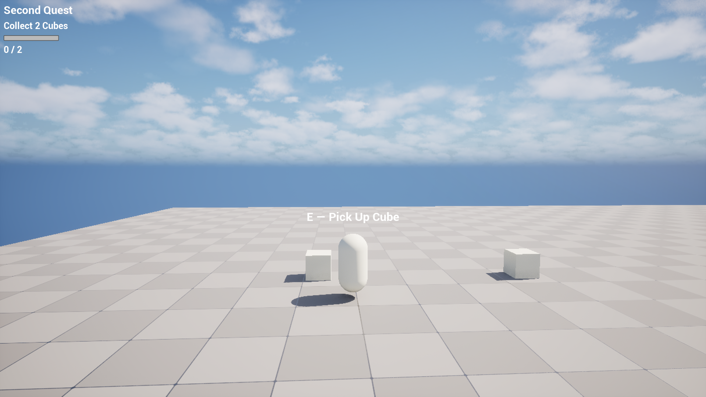
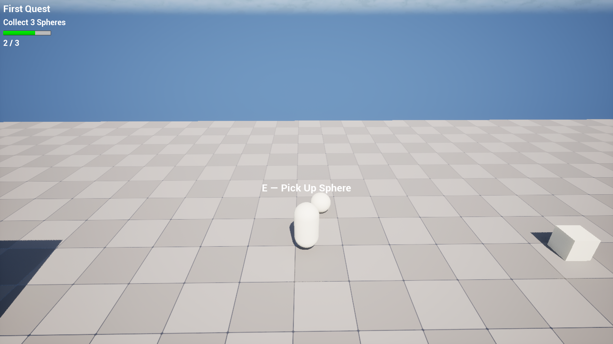
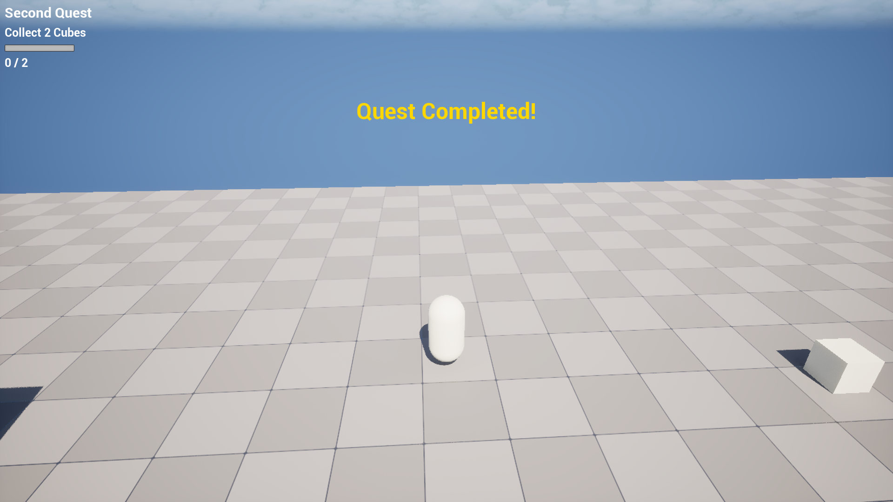
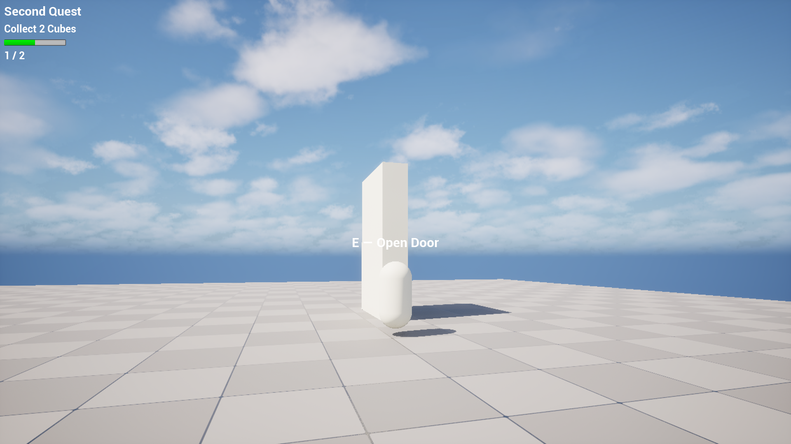

[Русская версия](README_RU.md)

# Interaction Toolkit

A reusable plugin for Unreal Engine 5 that adds an interaction system and a quest system to any project.

## What it is

Interaction Toolkit is a plugin that provides two independent systems:
1. **Interaction System** — allows the player to interact with objects (doors, chests, NPCs) using a generic interface.
2. **Quest System** — tracks objectives, progress, and completion with a tracker HUD.

The plugin can be dropped into any UE5 project and used without modifying its source code.

## Controls

- WASD — movement
- Mouse — look
- E — interact

## Features

- **Interaction System**
  - `IInteractionInterface` — generic interface for interactable objects
  - `UInteractionComponent` — finds the nearest interactable object using `OverlapMultiByChannel`
  - Interaction prompt UI (`WBP_InteractionPrompt`)
  - Timer-based search (10 times per second)

- **Quest System**
  - `UQuestData` — DataAsset for quest configuration
  - `FQuestObjective` — struct for individual objectives
  - `UQuestComponent` — tracks active quests and progress
  - Quest tracker HUD (`WBP_QuestHUD`) — shows the active quest, switches to the next one, hides when all complete
  - Delegates: `OnQuestCompleted`, `OnObjectiveProgress`

## Tech

Unreal Engine 5.6, C++ (core logic), Blueprint (UI), Enhanced Input (for demo).

## How to use

1. Copy the `InteractionToolkit` folder to your project's `Plugins/` directory.
2. Enable the plugin in **Edit → Plugins → Interaction Toolkit**.
3. Restart the editor.

### Interaction

1. Implement `IInteractionInterface` on any actor (door, chest, NPC).
2. Add `UInteractionComponent` to your character.
3. Set `Prompt Class` to `WBP_InteractionPrompt` in the component details.

### Quests

1. Create a `UQuestData` DataAsset (right-click → Miscellaneous → Data Asset → QuestData).
2. Add `UQuestComponent` to your character.
3. Set `Quest HUD Class` to `WBP_QuestHUD`.
4. Call `StartQuest` to begin a quest.
5. Call `UpdateProgress` when an objective is completed.

## Screenshots

## Download

[Google Drive link](https://drive.google.com/file/d/19G90FR8aK15tyeaukxFMfoStj-7fWYFp/view?usp=sharing)

**Platform:** Windows 64-bit  
Unzip the archive and run `InteractionDemo.exe`.

## Video

[Plugin demo on YouTube](https://youtu.be/ew1aC2qPtEQ)

## Known Limitations

- Demo project, not for production use.
- No save/load for quest progress between sessions.
- Windows 64-bit only.

## Contact

GitHub: [EduardNarezhnev](https://github.com/EduardNarezhnev)